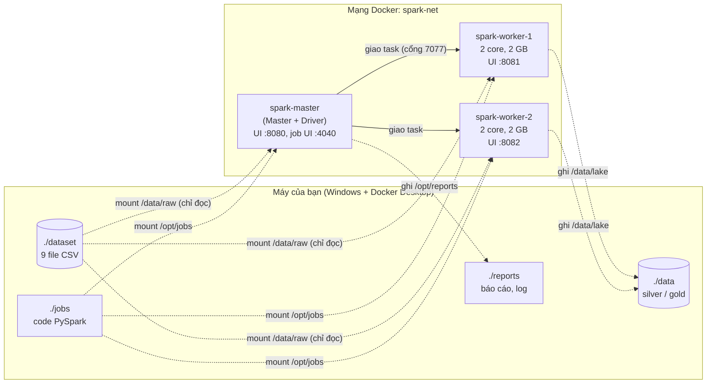

# 01 - Môi trường Spark (giải thích cho người làm web)

Tài liệu này giải thích **bước 2: dựng cụm Spark bằng Docker**: Spark là gì, các thành phần
làm gì, file `docker-compose.yml` cấu hình những gì, và cách theo dõi job đang chạy.

---

## 1. Vì sao cần Spark mà không dùng Pandas?

Pandas đọc **toàn bộ dữ liệu vào RAM của 1 máy** và xử lý bằng 1 CPU core. Với vài trăm MB
thì không sao, nhưng khi dữ liệu lên tới hàng chục/hàng trăm GB thì:

- không đủ RAM để chứa,
- 1 core xử lý quá chậm,
- máy chết là mất hết, phải chạy lại từ đầu.

**Apache Spark** giải quyết bằng cách **chia dữ liệu thành nhiều mảnh (partition)** và
**xử lý các mảnh song song trên nhiều máy (worker)**. Code ta viết gần giống SQL/Pandas,
còn Spark lo việc chia, gửi, gom kết quả, và chạy lại phần bị lỗi.

> Ví von: Pandas giống 1 nhân viên làm hết việc. Spark giống 1 quản lý (master) chia việc
> cho cả đội (workers), mỗi người làm 1 phần rồi nộp kết quả lại.

Bộ dữ liệu Olist hiện tại chỉ ~120 MB (Pandas vẫn xử lý được). Ta dùng Spark vì:
1. Pipeline phải **mở rộng được**: code này giữ nguyên khi dữ liệu tăng 10x, 100x
   (chỉ cần thêm worker). Bước thí nghiệm sau sẽ nhân bản dữ liệu để chứng minh điều này.
2. Đây là công cụ chuẩn của giai đoạn Processing trong đồ án.

---

## 2. Từ điển thuật ngữ (Spark ↔ Web)

| Thuật ngữ Spark | Nghĩa | Tương đương bên web |
|---|---|---|
| **Cluster** (cụm) | Nhóm máy cùng xử lý dữ liệu | Cụm server sau load balancer |
| **Master** | Quản lý cụm: biết có bao nhiêu worker, cấp tài nguyên cho job | Load balancer / Kubernetes control plane |
| **Worker** | Máy cung cấp CPU + RAM | 1 server / 1 node |
| **Executor** | Tiến trình chạy trên worker, thực thi phần việc được giao | 1 process của app (vd 1 instance Node.js) |
| **Driver** | Chương trình chính (file `.py` của ta): lên kế hoạch, chia việc, nhận kết quả | Client gọi API / orchestrator |
| **Job / Stage / Task** | 1 action → 1 job; job chia thành stage; mỗi stage có nhiều task (1 task / partition) | Request → các bước xử lý → các worker thread |
| **Partition** | 1 mảnh của bảng dữ liệu. Số partition = số task chạy song song được | Sharding / pagination |
| **DataFrame** | Bảng dữ liệu phân tán, có cột & kiểu | Bảng SQL / mảng object JSON |
| **Transformation** (`select`, `filter`, `join`...) | Mô tả phép biến đổi, **chưa chạy** | Query builder chưa gọi `.get()` |
| **Action** (`count`, `collect`, `write`...) | Kích hoạt chạy thật | Gọi `.get()` / `await` |
| **Shuffle** | Chuyển dữ liệu giữa các worker qua mạng (khi join, groupBy) | Gọi API chéo giữa các service - chậm, tốn mạng |
| **Cache** | Giữ DataFrame trong RAM để dùng lại | Redis cache |
| **spark-submit** | Lệnh gửi 1 file code lên cụm để chạy | `npm run`, `node app.js` |

---

## 3. Kiến trúc cụm trong project



Bản dạng chữ (nếu trình xem không hỗ trợ Mermaid):

```
             spark-submit 01_profiling.py
                        │
              ┌─────────▼─────────┐
              │   spark-master    │  ← Driver chạy ở đây: lên kế hoạch, chia task,
              │  (Master + Driver)│     nhận kết quả nhỏ, ghi báo cáo
              └───┬───────────┬───┘
         task     │           │     task
        ┌─────────▼──┐     ┌──▼─────────┐
        │  worker-1  │     │  worker-2  │  ← Executor đọc CSV, đếm, join...
        │ 2 core 2GB │     │ 2 core 2GB │
        └─────┬──────┘     └──────┬─────┘
              └──── /data/raw ────┘          ← thư mục dataset/ dùng chung
```

### Tại sao mọi container đều mount cùng thư mục `dataset/`?

Executor trên worker **tự đọc file** (master không đọc rồi gửi đi), nên mọi node phải thấy
file ở **cùng một đường dẫn** `/data/raw`. Trong hệ thống thật, chỗ này là kho lưu trữ dùng
chung như **HDFS, Amazon S3 hoặc MinIO** - đó là đầu ra của nhóm Storage. Ở đây ta
giả lập bằng thư mục chia sẻ của Docker.

---

## 4. Giải thích `docker-compose.yml`

| Phần | Ý nghĩa |
|---|---|
| `image: apache/spark:3.5.3-python3` | Image chính thức của Apache, có sẵn Java 11 + Spark 3.5.3 + Python 3.8. Không cần cài Java/Spark trên Windows. |
| `x-spark-common: &spark-common` và `<<: *spark-common` | YAML anchor: viết cấu hình chung 1 lần rồi dùng lại cho 3 service (giống biến/mixin). |
| `command: spark-class ...Master` | Container này chạy vai trò Master. |
| `command: spark-class ...Worker spark://spark-master:7077` | Container chạy vai trò Worker và đăng ký với master qua hostname `spark-master` (Docker tự phân giải DNS trong mạng `spark-net`). |
| `SPARK_WORKER_CORES=2`, `SPARK_WORKER_MEMORY=2g` | Giới hạn tài nguyên mỗi worker. Tổng cụm: 4 core, 4 GB. |
| `SPARK_NO_DAEMONIZE=true` | Chạy tiến trình ở foreground, nếu không container sẽ thoát ngay. |
| `volumes` | Mount thư mục của máy thật vào container (`dataset` chỉ đọc `:ro`). |
| `ports` | Mở các trang Web UI ra máy thật (xem mục 6). |

Muốn thử nghiệm khả năng mở rộng, có thể thêm `spark-worker-3` bằng cách sao chép khối
`spark-worker-2`, đổi tên và cổng UI.

---

## 5. Chuyện gì xảy ra khi chạy `spark-submit`?

```
docker compose exec spark-master /opt/spark/bin/spark-submit \
    --master spark://spark-master:7077 /opt/jobs/01_profiling.py
```

1. `docker compose exec spark-master ...`: chạy lệnh **bên trong** container master.
2. `spark-submit` khởi động **Driver** (chạy file Python của ta).
3. Driver xin master tài nguyên; master bảo mỗi worker bật 1 **executor** (2 core, 1 GB).
4. Code gặp một **action** (`.count()`, `.collect()`): driver biến chuỗi phép biến đổi
   thành kế hoạch thực thi (DAG), chia thành **stage** và **task** (mỗi partition 1 task).
5. Task được gửi tới executor; 4 core nên chạy tối đa 4 task cùng lúc.
6. Executor gửi **kết quả nhỏ** (vài con số) về driver; driver ghi báo cáo ra `/opt/reports`.
7. `spark.stop()`: trả tài nguyên, executor tắt.

---

## 6. Các trang Web UI để theo dõi (và chụp ảnh minh chứng cho báo cáo)

| URL | Xem gì |
|---|---|
| http://localhost:8080 | **Master UI**: danh sách worker đang sống, core/RAM, các ứng dụng đang chạy / đã xong |
| http://localhost:4040 | **Application UI** (chỉ có khi job đang chạy): tab *Jobs*, *Stages* (số task, thời gian, dung lượng shuffle), *Storage* (bảng nào đang cache), *SQL / DataFrame* (sơ đồ DAG của từng truy vấn), *Executors* |
| http://localhost:8081, http://localhost:8082 | **Worker UI**: executor nào đang chạy trên worker này, log stdout/stderr |

> Mẹo: job profiling chạy khoảng 1 phút. Mở http://localhost:4040 ngay sau khi chạy lệnh
> để chụp tab *Stages* và *SQL / DataFrame*, rồi đưa ảnh vào mục "Kết quả demo" của báo cáo.

---

## 7. Hạn chế của môi trường này (nên ghi vào mục Thảo luận)

- Cả 3 "máy" thực chất là 3 container trên **cùng 1 máy vật lý**, dùng chung CPU, RAM và ổ
  đĩa. Ta chứng minh được **mô hình** phân tán, nhưng tốc độ không tăng tuyến tính như
  khi có nhiều máy thật.
- Dùng thư mục chia sẻ thay cho HDFS/S3, nên không có cơ chế nhân bản dữ liệu
  (replication) và data locality của HDFS.
- Cấu hình RAM nhỏ (1 GB/executor) để chạy được trên laptop.
