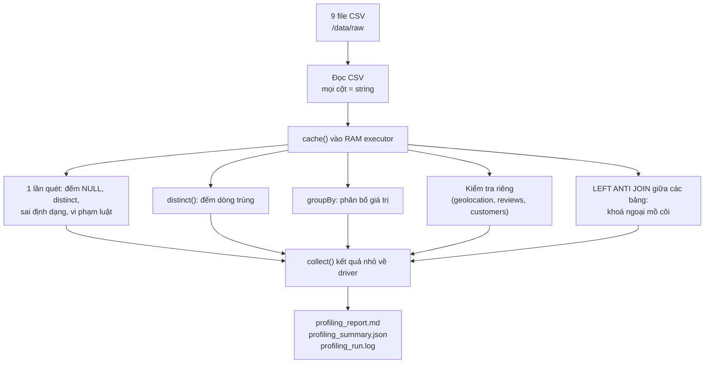

# 02 - Data Profiling: khảo sát chất lượng dữ liệu trước khi xử lý

Tài liệu này giải thích **bước 3**: job [`jobs/01_profiling.py`](../jobs/01_profiling.py)
làm gì, cách đọc báo cáo [`reports/profiling/profiling_report.md`](../reports/profiling/profiling_report.md),
và **những vấn đề dữ liệu đã tìm ra**, là đầu vào để thiết kế bước làm sạch (bước 4).

---

## 1. Profiling là gì, vì sao phải làm trước?

**Data profiling** là "khám sức khoẻ" cho dữ liệu: đo xem dữ liệu thiếu, trùng, sai định dạng
và mâu thuẫn ở đâu, mức độ bao nhiêu, **trước khi** sửa.

Bên web cũng có việc tương tự: trước khi viết migration cho một database cũ, ta chạy vài câu
`SELECT COUNT(*) ... WHERE email IS NULL` để biết có bao nhiêu dòng lỗi. Profiling làm việc
đó một cách có hệ thống cho mọi bảng và mọi cột, và lưu lại thành báo cáo.

Trong đồ án, profiling phục vụ 3 mục đích:
1. **Bằng chứng "dữ liệu trước xử lý"**: yêu cầu bắt buộc của giai đoạn Processing.
2. **Căn cứ thiết kế luật làm sạch**: sửa cái gì, sửa thế nào đều dựa trên số liệu ở đây.
3. **Chứng minh đặc trưng Big Data *Veracity***: dữ liệu thực tế không sạch.

---

## 2. Job hoạt động thế nào?

### Các quyết định thiết kế (và lý do)

| Quyết định | Lý do |
|---|---|
| Đọc **mọi cột là string**, không dùng `inferSchema` | Nếu để Spark tự ép kiểu, giá trị sai sẽ âm thầm thành NULL và ta không biết dữ liệu gốc lỗi. Ta tự thử ép kiểu bằng `try_cast` để **đếm** số giá trị sai. |
| Khai báo luật kiểm tra trong [`olist_tables.py`](../jobs/olist_tables.py) (data contract), không viết cứng trong code | Thêm/sửa luật chỉ cần sửa cấu hình. Bước làm sạch sau dùng lại file này. |
| Gom mọi phép đếm vào **một** `df.agg(...)` | Spark chỉ quét dữ liệu 1 lần thay vì mỗi cột 1 lần. Mỗi executor đếm phần của mình rồi cộng lại, đúng mô hình **MapReduce**. |
| `approx_count_distinct` (HyperLogLog) | Đếm chính xác số giá trị khác nhau phải nhớ mọi giá trị, rất tốn RAM khi dữ liệu lớn. Thuật toán xấp xỉ dùng vài KB, sai số khoảng 5%. |
| `cache()` từng bảng | Mỗi bảng được quét 5-10 lần (đếm, distinct, groupBy, join). Không cache thì lần nào cũng phải đọc và parse lại CSV. |
| Chỉ bật `multiLine` cho `reviews` | Xem mục 5.2. |
| Chỉ `.collect()` **kết quả tổng hợp** | `.collect()` kéo dữ liệu về RAM của driver; kéo cả bảng lớn sẽ làm driver sập. |

---

## 3. Cách đọc báo cáo

| Mục / Cột trong báo cáo | Ý nghĩa |
|---|---|
| **Partition** | Spark chia bảng thành bao nhiêu mảnh, cũng là số task chạy song song khi quét bảng |
| **Dòng trùng hoàn toàn** | Số dòng giống hệt một dòng khác ở **mọi** cột |
| **Trùng khoá chính** | Số dòng có khoá chính (vd `review_id`) đã xuất hiện ở dòng khác, dù các cột còn lại có thể khác |
| **Thiếu (NULL/rỗng)** | Ô trống hoặc chỉ có khoảng trắng |
| **Số giá trị khác nhau (≈)** | Giá trị **xấp xỉ**, sai số khoảng 5%. Vì vậy `order_id` có thể hiện 99,770 dù bảng chỉ có 99,441 dòng; con số chính xác nằm ở cột "Trùng khoá chính". |
| **Sai định dạng** | Ô có giá trị nhưng không ép được sang kiểu mong đợi (vd ngày `2017-13-45`) |
| **Kiểm tra luật nghiệp vụ** | Số dòng vi phạm từng luật khai báo trong `olist_tables.py` |
| **Khoá ngoại mồ côi** | Dòng ở bảng con trỏ tới khoá không tồn tại ở bảng cha (giống vi phạm FOREIGN KEY) |

---

## 4. Kết quả chính (lần chạy ngày 2026-10-28)

**Quy mô:** 9 bảng, **120 MB**, **1.550.922 bản ghi**. Cụm 2 executor × 2 core. Toàn bộ job
mất khoảng **45-55 giây**.

### 4.1. Các vấn đề tìm thấy và hướng xử lý ở bước làm sạch

| # | Bảng | Vấn đề | Số liệu | Hướng xử lý đề xuất |
|---|---|---|---|---|
| 1 | geolocation | Dòng trùng hoàn toàn | **261.831 dòng (26%)** | Loại trùng |
| 2 | geolocation | Một mã zip có nhiều dòng toạ độ | 19.015 zip, trung bình **52,6 dòng/zip**, tối đa 1.146 | Gộp còn 1 dòng/zip (lấy toạ độ trung bình), giảm từ 1 triệu xuống khoảng 19 nghìn dòng |
| 3 | geolocation | Tên thành phố viết không thống nhất (`são paulo` / `sao paulo`) | 8.556 zip có hơn 1 cách viết; **chỉ còn 547** sau khi chuẩn hoá (chữ thường, bỏ dấu, bỏ ký tự rác). 8.011 cách viết thu về 5.964 tên. Ngoài ra còn vài chục tên lỗi như `florian&oacute;polis`, `sa£o paulo`, `´teresopolis`. | Chuẩn hoá bằng `normalize_text()` trong `jobs/common.py`, rồi lấy tên phổ biến nhất của mỗi zip |
| 4 | geolocation | Toạ độ nằm ngoài Brazil | 42 dòng | Loại bỏ trước khi tính trung bình |
| 5 | reviews | `review_id` bị trùng | **814 dòng**: 789 `review_id`, mỗi id gắn với 2 đơn trở lên. Cặp (`review_id`, `order_id`) thì không trùng. | Dùng khoá ghép (`review_id`, `order_id`) |
| 6 | reviews | Một đơn có nhiều review | 547 đơn | Giữ review mới nhất cho mỗi đơn khi join |
| 7 | reviews | Không có tiêu đề / nội dung bình luận | 88,3% / 58,7% | Bình thường (khách chỉ chấm sao), giữ NULL, **không** loại bỏ |
| 8 | orders | Đơn `delivered` thiếu ngày giao | 8 đơn | Gắn cờ (flag) bất thường |
| 9 | orders | Ngày giao cho vận chuyển sớm hơn ngày mua | 166 đơn | Gắn cờ bất thường |
| 10 | orders | Thiếu ngày duyệt / ngày giao | 160 / 2.965 đơn | Phần lớn là đơn chưa giao hoặc đã huỷ, nên hợp lệ. Giữ NULL. |
| 11 | orders | Đơn không có dòng sản phẩm | 775 đơn (603 `unavailable`, 164 `canceled`, 8 trạng thái khác) | Loại khỏi bảng doanh thu |
| 12 | orders | Đơn không có thanh toán | 1 đơn | Gắn cờ |
| 13 | payments | `not_defined`, 0 kỳ trả góp, số tiền ≤ 0 | 3 / 2 / 9 dòng | Gắn cờ hoặc loại |
| 14 | products | Không có danh mục; cả 610 sản phẩm này đều trống luôn 3 cột tên/mô tả/số ảnh | 610 sản phẩm (1,85%) | Gán danh mục `unknown` |
| 15 | products | Danh mục chưa có bản dịch tiếng Anh | 13 sản phẩm, 2 danh mục | Bổ sung bản dịch thủ công |
| 16 | products | Tên cột sai chính tả `product_name_lenght`, `product_description_lenght` | - | Đổi tên thành `..._length` |
| 17 | products | Khối lượng 0 gram / thiếu kích thước | 4 / 2 sản phẩm | Gán NULL |
| 18 | customers, sellers | Mã zip không có trong bảng toạ độ | 157 zip khách hàng, 7 zip người bán | Toạ độ để NULL (dùng left join) |
| 19 | customers | `customer_id` sinh mới cho **mỗi đơn**, không phải mỗi người | 99.441 `customer_id` nhưng chỉ có **96.096 khách thật** | Dùng `customer_unique_id` khi phân tích khách hàng |
| 20 | Tất cả | Ngày giờ lưu dạng chuỗi | Không có giá trị sai định dạng | Ép sang `timestamp` |

### 4.2. Những điểm dữ liệu "sạch"

- Không bảng nào có dòng trùng hoàn toàn, **trừ geolocation**.
- Mọi khoá ngoại chính (`order_items` → `orders`/`products`/`sellers`, `payments` → `orders`,
  `reviews` → `orders`, `orders` → `customers`) đều **không có dòng mồ côi**.
- Không có giá trị ngày/số sai định dạng; điểm review đều nằm trong khoảng 1-5.

> Kết luận: dữ liệu Olist **dùng được nhưng không thể dùng thẳng**. Đặc biệt bảng
> geolocation chiếm **48% dung lượng** nhưng 26% là dòng trùng. Nếu join thẳng bảng này với
> customers mà không gộp trước, số dòng sẽ phình lên khoảng 50 lần (mỗi khách nhân với khoảng
> 52 dòng toạ độ). Đây là lỗi kinh điển khi xử lý dữ liệu lớn.

---

## 5. Bài học kỹ thuật rút ra khi chạy

### 5.1. Chờ executor trước khi đọc dữ liệu
Ở lần chạy đầu, job đọc dữ liệu ngay khi vừa tạo SparkSession, lúc các worker chưa kịp đăng
ký executor. Spark tưởng cụm chỉ có 2 core nên chia ít partition. Ta thêm hàm
`wait_for_executors()` để chờ đủ executor rồi mới bắt đầu.

### 5.2. `multiLine` làm mất khả năng song song
Lần chạy đầu bật `multiLine=True` cho **mọi** file, nên **bảng nào cũng chỉ có 1 partition**:
cả cụm 4 core nhưng mỗi bảng chỉ được 1 core xử lý.

Nguyên nhân: để đọc song song, Spark cắt file theo byte (vd byte 0-15MB, 15-30MB...). Nếu
một giá trị có thể chứa dấu xuống dòng thì vết cắt có thể rơi vào giữa một bản ghi, nên
Spark buộc phải đọc cả file bằng 1 task. Chỉ `reviews` thật sự có bình luận nhiều dòng. Sau
khi chỉ bật `multiLine` cho bảng này:

| Bảng | Partition (multiLine cho mọi file) | Partition (multiLine chỉ cho reviews) |
|---|---:|---:|
| orders | 1 | 4 |
| order_items | 1 | 4 |
| geolocation | 1 | 4 |
| reviews | 1 | 1 |

Thời gian xử lý geolocation (1 triệu dòng) giảm từ **10,3 giây xuống 6,4 giây**.

> Hướng cải tiến: ở các bước sau, lưu dữ liệu dưới dạng **Parquet** (định dạng cột, chia
> mảnh được, có nén) thay cho CSV. Khi đó vấn đề này không còn.

### 5.3. Thời gian bảng đầu tiên luôn lâu hơn
Bảng `orders` mất khoảng 11-14 giây dù chỉ có 99 nghìn dòng, còn `order_items` cùng cỡ chỉ mất
khoảng 4 giây. Nguyên nhân là chi phí khởi động lần đầu (JVM warm-up, nạp class, khởi tạo
executor). Vì vậy khi đo hiệu năng ở bước thí nghiệm, nên **chạy vài lần và lấy trung bình**,
bỏ lần chạy đầu.

### 5.4. Ký tự BOM trong file dịch danh mục
File `product_category_name_translation.csv` bắt đầu bằng ký tự ẩn BOM (`U+FEFF`), thường
do Excel chèn vào. Nếu không xử lý, tên cột thành `product_category_name` và join
theo tên cột sẽ lỗi. Spark 3.5 tự bỏ BOM khi đọc với `encoding=UTF-8`; job vẫn kiểm tra và
ghi vào mục 3 của báo cáo nếu phát hiện, để phòng trường hợp dùng công cụ khác.

---

## 6. Đặc trưng Big Data thể hiện qua bước này (dùng cho mục 5.2 của đồ án)

| Đặc trưng | Bằng chứng |
|---|---|
| **Veracity** (độ tin cậy) | 20 loại vấn đề ở mục 4.1: 26% dòng geolocation trùng, 814 review trùng khoá, tên địa danh không thống nhất, mốc thời gian mâu thuẫn |
| **Variety** (đa dạng) | 9 bảng quan hệ; kiểu dữ liệu gồm ID dạng hash, thời gian, số, toạ độ địa lý, **văn bản tự do tiếng Bồ Đào Nha** nhiều dòng |
| **Volume** (khối lượng) | Hiện tại 1,55 triệu bản ghi / 120 MB. Thí nghiệm nhân bản dữ liệu (x5, x10, x20) ở bước sau sẽ đo khả năng mở rộng |
