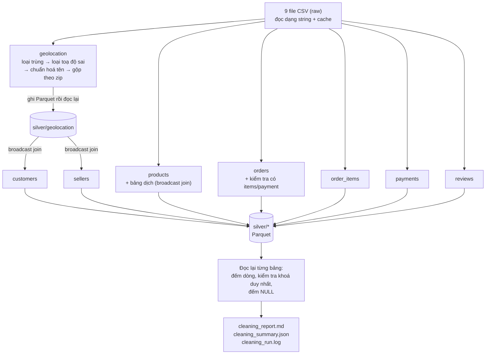

# 03 - Làm sạch & chuẩn hoá dữ liệu (raw CSV → silver Parquet)

Tài liệu này giải thích **bước 4**: job [`jobs/02_clean.py`](../jobs/02_clean.py) sửa
những vấn đề đã tìm thấy ở bước profiling như thế nào, dữ liệu đầu ra trông ra sao, và các
kỹ thuật Spark được dùng. Số liệu chi tiết của lần chạy nằm ở
[`reports/cleaning/cleaning_report.md`](../reports/cleaning/cleaning_report.md).

---

## 1. Vị trí trong pipeline: kiến trúc "medallion"

Data lake thường chia dữ liệu thành các tầng theo mức độ "sạch":

```
  raw / bronze                silver                          gold
  ─────────────               ──────                          ────
  CSV gốc, giữ nguyên   →     đã làm sạch, đúng kiểu,   →     bảng tổng hợp cho
  (dataset/)                  khoá duy nhất, có cờ chất       báo cáo/KPI
                              lượng (data/silver/)            (data/gold/ - bước 5)
       ▲                            ▲
   bước 3 khảo sát             bước 4 (tài liệu này)
```

Ví von bên web: **raw** là request body người dùng gửi lên, chưa validate. **silver** là dữ
liệu đã qua validate, sanitize và lưu vào DB đúng schema. **gold** là các view/báo cáo
dựng từ DB.

**Không bao giờ sửa tầng raw.** Nếu luật làm sạch sai, chỉ cần sửa code và chạy lại job để
sinh lại silver từ raw.

---

## 2. Bốn loại thao tác và lý do chọn

| Loại | Khi nào dùng | Ví dụ |
|---|---|---|
| **Loại bỏ** | Dòng chắc chắn là rác, giữ lại chỉ gây sai số liệu | 261.831 dòng toạ độ trùng hoàn toàn; 33 toạ độ nằm ngoài Brazil |
| **Sửa** | Lỗi kỹ thuật, sửa xong không làm đổi ý nghĩa dữ liệu | Ép chuỗi sang timestamp/decimal; đổi tên cột `lenght` → `length`; `São Paulo` → `sao paulo` |
| **Gắn cờ** | Bất thường **nghiệp vụ**: có thể là lỗi, cũng có thể là tình huống thật | Đơn giao cho vận chuyển trước ngày mua; thanh toán 0 đồng |
| **Bổ sung** | Thêm cột tính sẵn mà bước sau chắc chắn cần | `delivery_days`, `is_late`, toạ độ khách hàng, tên danh mục tiếng Anh |

**Vì sao gắn cờ thay vì xoá?** Ví dụ có 9 thanh toán 0 đồng. Kiểm tra cho thấy 6 trong số
đó là **voucher 0 đồng** của đơn đã giao hoặc đang giao, tức là dữ liệu thật chứ không phải
lỗi; 3 dòng còn lại là `not_defined` của đơn đã huỷ. Nếu
xoá, tổng số lần thanh toán bằng voucher sẽ sai. Với cột cờ `dq_zero_value`, nhóm Analytics
tự chọn:

```sql
SELECT ... FROM payments WHERE NOT dq_zero_value   -- bỏ qua nếu muốn
```

Mọi cột cờ `dq_*` **luôn là true/false, không bao giờ NULL** (hàm `flag()` trong code). Lý do:
trong SQL, `NULL = 0` cho ra `NULL`, và `WHERE NOT dq_x` sẽ âm thầm loại mất dòng có cờ NULL.

---

## 3. Luồng xử lý của job



`geolocation` được xử lý **trước**, vì `customers` và `sellers` cần toạ độ đã làm sạch của nó.

---

## 4. Từng vấn đề ở bước profiling được xử lý thế nào

Số thứ tự `#` khớp với bảng ở [docs/02-data-profiling.md](02-data-profiling.md#41-các-vấn-đề-tìm-thấy-và-hướng-xử-lý-ở-bước-làm-sạch).

| # | Vấn đề | Xử lý | Kết quả |
|---|---|---|---|
| 1 | geolocation: 26% dòng trùng | Loại bỏ (`dropDuplicates`) | -261.831 dòng |
| 2 | geolocation: khoảng 52 dòng / zip | Gộp 1 dòng / zip: toạ độ trung bình, `n_points` = số điểm gốc | 1.000.163 → **19.010 dòng**, 58 MB → **0,5 MB** |
| 3 | Tên thành phố không thống nhất | `normalize_text()`, rồi chọn tên phổ biến nhất của zip (window function) | 63.454 dòng được sửa |
| 4 | Toạ độ ngoài Brazil | Loại bỏ trước khi tính trung bình | -33 dòng (sau khi đã loại trùng); 5 zip chỉ có toạ độ sai nên mất hẳn |
| 5, 6 | reviews: `review_id` lặp ở nhiều đơn | Khoá chính = (`review_id`, `order_id`); gắn cờ `dq_review_id_reused` | 1.603 dòng có cờ. Việc chọn 1 review/đơn để ở bước 5. |
| 7 | Review không có bình luận | Giữ nguyên; thêm `has_comment`. Bình luận nhiều dòng được gộp thành 1 dòng. | 3.852 bình luận được gộp dòng |
| 8, 9, 11, 12 | Bất thường ở orders | Gắn cờ `dq_delivered_without_date`, `dq_carrier_before_purchase`, `dq_no_items`, `dq_no_payment` | 8 / 166 / 775 / 1 đơn |
| 10 | Thiếu ngày duyệt/giao | Giữ NULL (đơn chưa giao là hợp lệ) | - |
| 13 | payments bất thường | Gắn cờ `dq_undefined_type`, `dq_zero_installments`, `dq_zero_value` | 3 / 2 / 9 dòng |
| 14 | products không có danh mục | `unknown` + cờ `dq_missing_category` | 610 sản phẩm |
| 15 | 2 danh mục chưa có bản dịch | Dịch thủ công (`MANUAL_TRANSLATIONS`) + cờ `dq_translation_added_manually` | 13 sản phẩm |
| 16 | Tên cột sai chính tả | Đổi `..._lenght` → `..._length` | - |
| 17 | Khối lượng 0 gram | → NULL + cờ `dq_zero_weight` | 4 sản phẩm |
| 18 | Zip khách/người bán không có toạ độ | Left join (giữ dòng, `lat`/`lng` = NULL) + cờ `dq_zip_not_in_geolocation` | 279 khách hàng, 7 người bán |
| 19 | `customer_id` ≠ khách thật | Giữ cả `customer_id` và `customer_unique_id` trong silver | - |
| 20 | Ngày giờ, tiền dạng chuỗi | timestamp; tiền → `decimal(12,2)` | - |

> Ở #18, số khách hàng bị gắn cờ là 279, nhiều hơn 1 so với profiling (278). Lý do: 5 mã zip
> chỉ có toạ độ nằm ngoài Brazil nên bị loại hẳn ở #4, và 1 khách hàng ở một trong các zip đó.

---

## 5. Đầu ra: các bảng silver (giao diện dữ liệu cho bước sau)

Tất cả ở dạng **Parquet** trong `data/silver/<bảng>/`.

| Bảng | Số dòng | Khoá chính | Cột đáng chú ý |
|---|---:|---|---|
| `geolocation` | 19.010 | `zip_code_prefix` | `city`, `state`, `lat`, `lng`, `n_points` |
| `customers` | 99.441 | `customer_id` | `customer_unique_id` (khách thật), `zip_code_prefix`, `city`, `state`, `lat`, `lng`, `dq_zip_not_in_geolocation` |
| `sellers` | 3.095 | `seller_id` | `zip_code_prefix`, `city`, `state`, `lat`, `lng`, `dq_zip_not_in_geolocation` |
| `products` | 32.951 | `product_id` | `product_category_name`, `product_category_name_english`, kích thước/khối lượng, `dq_missing_category`, `dq_zero_weight` |
| `orders` | 99.441 | `order_id` | 5 cột timestamp, `delivery_days`, `delivery_delay_days`, `is_late`, 4 cờ `dq_*`. **Chia thư mục theo `purchase_year`/`purchase_month`.** |
| `order_items` | 112.650 | (`order_id`, `order_item_id`) | `price`, `freight_value`, `item_total` (decimal) |
| `payments` | 103.886 | (`order_id`, `payment_sequential`) | `payment_type`, `payment_installments`, `payment_value`, 3 cờ `dq_*` |
| `reviews` | 99.224 | (`review_id`, `order_id`) | `review_score`, bình luận (1 dòng), `has_comment`, `dq_review_id_reused` |

Schema đầy đủ (tên cột, kiểu, % NULL) và bản ghi mẫu: mục 4 của
[cleaning_report.md](../reports/cleaning/cleaning_report.md).

**Ý nghĩa các cột bổ sung trong `orders`:**

| Cột | Công thức | Ghi chú |
|---|---|---|
| `delivery_days` | ngày khách nhận − ngày mua | NULL nếu chưa giao |
| `delivery_delay_days` | ngày khách nhận − ngày dự kiến | Âm = giao sớm, dương = trễ |
| `is_late` | ngày nhận > ngày dự kiến | NULL nếu chưa giao |

### Cấu trúc thư mục `orders` (partition theo thời gian)

```
data/silver/orders/
├── purchase_year=2016/
│   ├── purchase_month=9/part-00000-....snappy.parquet
│   └── ...
├── purchase_year=2017/ (12 tháng)
└── purchase_year=2018/ (10 tháng)
```

Câu truy vấn `WHERE purchase_year = 2018` chỉ cần mở thư mục `purchase_year=2018`
(gọi là **partition pruning**), tương tự index theo ngày trong database.

### Cách đọc silver (cho nhóm Analytics)

```python
orders = spark.read.parquet("/data/lake/silver/orders")
orders.createOrReplaceTempView("orders")
spark.sql("""
    SELECT purchase_year, purchase_month, AVG(delivery_days) AS avg_days
    FROM orders
    WHERE order_status = 'delivered' AND NOT dq_carrier_before_purchase
    GROUP BY purchase_year, purchase_month
""").show()
```

Ngoài Spark, Parquet còn đọc được bằng Pandas (`pd.read_parquet`, cần `pyarrow`), DuckDB,
Power BI, v.v.

---

## 6. Kỹ thuật Spark dùng trong job

| Kỹ thuật | Ở đâu | Giải thích |
|---|---|---|
| **Broadcast join** | customers/sellers ⨝ geolocation; products ⨝ bảng dịch | Bảng nhỏ được gửi nguyên bản tới **mọi** executor, nên bảng lớn không phải shuffle qua mạng. Giống cache 1 bảng tra cứu nhỏ trong RAM của từng server. |
| **Window function** | `most_frequent()`: tên thành phố phổ biến nhất mỗi zip; `dq_review_id_reused` | `ROW_NUMBER() OVER (PARTITION BY zip ORDER BY count DESC)`, giống SQL |
| **`spark.sql.shuffle.partitions = 16`** | Cấu hình SparkSession | Mặc định 200 dành cho cụm lớn. Với 4 core, 200 task tí hon thì chi phí điều phối còn lớn hơn chi phí xử lý. |
| **`repartition` trước `partitionBy`** | `write_parquet()` trong `common.py` (orders) | Nếu không làm, mỗi task ghi 1 file nhỏ vào **mọi** thư mục tháng, tạo ra hàng trăm file vài KB ("small files problem"). Sau khi repartition: đúng **25 file cho 25 tháng**. |
| **Ghi rồi đọc lại** | `silver[name] = spark.read.parquet(...)` | Bảng sau (customers) dùng geolocation **đã ghi** thay vì tính lại cả chuỗi biến đổi (lazy evaluation sẽ tính lại từ CSV nếu dùng DataFrame cũ). |
| **Kiểm tra sau khi ghi** | `validate_silver()` | Đọc lại Parquet từ đĩa để chứng minh dữ liệu dùng được và khoá chính thật sự duy nhất. |
| **`decimal(12,2)` cho tiền** | order_items, payments | `double` có lỗi làm tròn (0.1 + 0.2 = 0.30000000000000004); tiền phải dùng decimal, giống `DECIMAL` trong MySQL. |

---

## 7. Kết quả (lần chạy 2026-10-28)

| Chỉ số | Trước (raw CSV) | Sau (silver Parquet) |
|---|---:|---:|
| Tổng số dòng | 1.550.922 | 569.698 |
| Dung lượng | 120,35 MB | **40,37 MB** (giảm 66%) |
| Dòng trùng hoàn toàn | 261.831 | 0 |
| Trùng khoá chính | 814 (reviews) | **0 ở cả 8 bảng** |
| Kiểu dữ liệu | Tất cả là string | timestamp, int, double, decimal, boolean |
| Thời gian chạy | | khoảng 70 s (làm sạch + ghi 46 s, kiểm tra lại 10 s) |

Dung lượng giảm chủ yếu nhờ gộp geolocation (58 MB → 0,5 MB). Các bảng toàn mã hash như
`customers` gần như không nén được (8,6 → 7,8 MB) vì chuỗi hash ngẫu nhiên, không có quy luật lặp.

---

## 8. Hạn chế và hướng cải tiến (cho mục Thảo luận)

- **Ghi đè toàn bộ** (`mode("overwrite")`) mỗi lần chạy. Với dữ liệu tăng liên tục, nên xử lý
  tăng dần (incremental), chỉ xử lý tháng mới. Có thể dùng **Delta Lake** để có `MERGE`,
  transaction và lịch sử phiên bản.
- **Toạ độ trung bình theo zip** là xấp xỉ, đủ cho bản đồ theo vùng nhưng không chính xác
  tới từng địa chỉ.
- **Bảng reviews vẫn chỉ có 1 partition khi đọc** (do `multiLine`). Từ silver trở đi thì
  không còn vấn đề này, vì Parquet chia mảnh được.
- **Tên thành phố lỗi mã hoá** (vd `sa£o paulo`) chỉ được loại bỏ ký tự rác, không khôi phục
  được hoàn toàn. Việc chọn tên phổ biến nhất của zip giúp hạn chế ảnh hưởng.
- **Dịch danh mục thủ công** được viết cứng trong code. Nếu có nhiều danh mục mới, nên
  chuyển thành file cấu hình.
