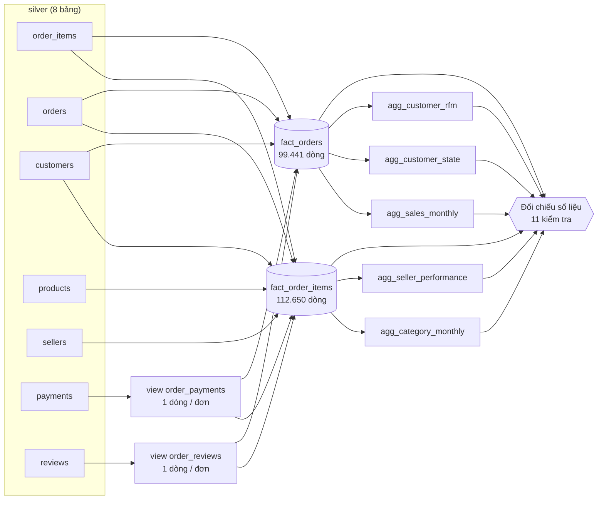

# 04 - Kết hợp & tổng hợp dữ liệu (silver → gold) bằng Spark SQL

Tài liệu này giải thích **bước 5**: job [`jobs/03_gold.py`](../jobs/03_gold.py) cùng các
câu SQL trong [`jobs/sql/`](../jobs/sql/) join 8 bảng silver thành **2 bảng fact**, rồi tổng
hợp thành **5 bảng KPI** cho nhóm Analytics / dashboard. Số liệu lần chạy nằm ở
[`reports/gold/gold_report.md`](../reports/gold/gold_report.md).

---

## 1. Ý tưởng: dọn sẵn dữ liệu cho người đọc

Tầng silver vẫn **chuẩn hoá** (normalized) như database của một web app: 8 bảng tách rời,
liên kết bằng khoá. Muốn biết "doanh thu theo danh mục, theo bang của khách" thì phải join
5-6 bảng. Mỗi người phân tích tự join thì vừa chậm, vừa dễ sai (xem mục 4).

Tầng gold **phi chuẩn hoá** (denormalized): join sẵn một lần, đúng cách, rồi lưu lại.

| Khái niệm | Nghĩa | Bên web |
|---|---|---|
| **Bảng fact** | Mỗi dòng là một sự kiện kinh doanh (1 sản phẩm được bán, 1 đơn hàng), đã gắn sẵn mọi thông tin mô tả | Response API đã "eager load" mọi quan hệ, thay vì client phải gọi N request |
| **Bảng tổng hợp (aggregate)** | Kết quả `GROUP BY` tính sẵn: doanh thu theo tháng, theo bang... | Materialized view / dữ liệu cache cho trang dashboard |
| **Độ hạt (grain)** | "1 dòng = cái gì". Phải xác định rõ trước khi viết SQL. | |

---

## 2. Luồng xử lý



Job chạy các file SQL **theo thứ tự** khai báo trong `STEPS`. Mỗi bảng được ghi ra Parquet
rồi **đọc lại** để bước sau dùng bản đã ghi. Nếu dùng DataFrame cũ, lazy evaluation sẽ
khiến Spark tính lại toàn bộ chuỗi join.

---

## 3. Các bảng gold (giao diện dữ liệu cho nhóm Analytics)

Tất cả nằm trong `data/gold/<bảng>/` (Parquet).

| Bảng | 1 dòng = | Số dòng | File SQL | Dùng để trả lời |
|---|---|---:|---|---|
| `fact_order_items` | 1 sản phẩm trong 1 đơn | 112.650 | [fact_order_items.sql](../jobs/sql/fact_order_items.sql) | Mọi câu hỏi theo sản phẩm, danh mục, người bán, khoảng cách giao hàng |
| `fact_orders` | 1 đơn hàng | 99.441 | [fact_orders.sql](../jobs/sql/fact_orders.sql) | Giá trị đơn, giao hàng, review, khách hàng |
| `agg_sales_monthly` | 1 tháng | 24 | [agg_sales_monthly.sql](../jobs/sql/agg_sales_monthly.sql) | Xu hướng doanh thu, số đơn, tỷ lệ giao trễ theo thời gian |
| `agg_category_monthly` | 1 danh mục × 1 tháng | 1.282 | [agg_category_monthly.sql](../jobs/sql/agg_category_monthly.sql) | Danh mục bán chạy, mùa vụ |
| `agg_customer_state` | 1 bang | 27 | [agg_customer_state.sql](../jobs/sql/agg_customer_state.sql) | Bản đồ doanh thu, phí ship và tốc độ giao theo vùng |
| `agg_seller_performance` | 1 người bán | 3.053 | [agg_seller_performance.sql](../jobs/sql/agg_seller_performance.sql) | Xếp hạng người bán, tìm người bán giao trễ / bị chấm điểm thấp |
| `agg_customer_rfm` | 1 khách thật | 94.983 | [agg_customer_rfm.sql](../jobs/sql/agg_customer_rfm.sql) | Phân nhóm khách hàng (Recency / Frequency / Monetary) |

Hai bảng fact được chia thư mục theo `purchase_year`/`purchase_month`, giống silver
`orders`. Bảng tổng hợp nhỏ nên ghi thành **1 file** để Power BI / Superset đọc cho tiện.

### Định nghĩa các chỉ số (thống nhất cho mọi bảng)

| Chỉ số | Định nghĩa |
|---|---|
| `is_valid_sale` | Đơn **không** ở trạng thái `canceled`/`unavailable` **và** có ít nhất 1 sản phẩm. Mọi bảng tổng hợp chỉ tính đơn hợp lệ: 98.199 trên 99.441 đơn. |
| `revenue` | Tổng **giá sản phẩm** (`price`), chưa gồm phí vận chuyển |
| `gmv` / `order_value` | Giá sản phẩm + phí vận chuyển = số tiền khách trả cho đơn |
| `payment_total` | Tổng tiền thanh toán thực tế. Có thể lệch `order_value` do lãi trả góp hoặc voucher. |
| `late_delivery_pct` | % đơn **đã giao** mà ngày nhận muộn hơn ngày dự kiến. Đơn chưa giao không tính. |
| `distance_km` | Khoảng cách đường chim bay từ người bán đến khách (công thức Haversine trên toạ độ zip) |
| `recency_days` | Số ngày từ lần mua cuối của khách đến ngày mua mới nhất trong dữ liệu |

---

## 4. Bẫy lớn nhất khi join: nhân bản dòng (fan-out)

Một đơn hàng có thể có **nhiều** dòng thanh toán (thẻ + voucher) và **nhiều** review. Nếu
join thẳng:

```sql
SELECT SUM(i.price) FROM order_items i
LEFT JOIN payments p ON i.order_id = p.order_id      -- 1 đơn, 3 lần thanh toán
LEFT JOIN reviews  r ON i.order_id = r.order_id      -- → mỗi sản phẩm bị nhân 3 lần
```

Kết quả đo trên dữ liệu thật:

| | Số dòng | Tổng doanh thu |
|---|---:|---:|
| Đúng (`order_items` gốc) | 112.650 | 13.591.643,70 |
| Join thẳng payments + reviews | 118.310 (**+5.660**) | 14.273.699,65 (**+682.055,95, tức +5%**) |

Lỗi này **không báo lỗi gì cả**, chỉ âm thầm cho ra số sai. Cách tránh:
**gom về đúng độ hạt trước khi join**:
- [order_payments.sql](../jobs/sql/order_payments.sql): gom payments về 1 dòng / đơn (`GROUP BY order_id`).
- [order_reviews.sql](../jobs/sql/order_reviews.sql): giữ review mới nhất của mỗi đơn (`ROW_NUMBER() ... = 1`).

---

## 5. Đối chiếu số liệu (reconciliation): chứng minh kết quả đúng

Sau khi tạo bảng, job chạy **11 cặp câu SQL**; mỗi cặp phải ra **cùng một con số**. Nếu
có cặp sai, job dừng với lỗi. Đây là kiểm thử tự động cho pipeline dữ liệu, tương tự unit
test bên web.

| Nhóm kiểm tra | Ý nghĩa |
|---|---|
| Fact giữ nguyên số dòng và tổng tiền của silver | Join không làm mất hay nhân bản dòng |
| Hai bảng fact cùng ra một doanh thu đơn hợp lệ | Định nghĩa `is_valid_sale` nhất quán |
| Tháng, danh mục, bang, người bán cộng lại đều bằng nhau | Bảng tổng hợp không bỏ sót hay đếm trùng |
| Số đơn và số khách trong RFM khớp | Bảng khách hàng đầy đủ |

Kết quả lần chạy: **11/11 đạt**. Doanh thu hợp lệ = **13.494.400,74** ở mọi bảng.

---

## 6. Spark thực thi các phép join thế nào?

Job lưu **kế hoạch thực thi** của từng bảng vào [`reports/gold/plans/`](../reports/gold/plans/)
(giống `EXPLAIN` trong MySQL). Với `fact_order_items`, Spark chọn **BroadcastHashJoin cho
cả 6 phép join**:

```
BroadcastHashJoin LeftOuter (order_payments)
 └ BroadcastHashJoin LeftOuter (order_reviews)
    └ BroadcastHashJoin Inner (sellers)
       └ BroadcastHashJoin Inner (products)
          └ BroadcastHashJoin Inner (customers)
             └ BroadcastHashJoin Inner (orders)
                └ Scan order_items
```

**Vì sao?** Spark tự broadcast bảng nhỏ hơn `spark.sql.autoBroadcastJoinThreshold`
(mặc định 10 MB). Các bảng silver đều dưới 10 MB nên được gửi nguyên bản tới mọi executor,
và **không phải shuffle** dữ liệu qua mạng.

**Khi dữ liệu lớn lên** (vd x20), các bảng vượt 10 MB. Lúc đó Spark chuyển sang
**SortMergeJoin**: chia cả 2 bảng theo khoá rồi chuyển qua mạng (shuffle) để các dòng cùng
khoá nằm chung một executor. Cách này chậm hơn nhưng không giới hạn kích thước. Đây là thí
nghiệm nên làm ở bước 6.

> AQE (Adaptive Query Execution, bật sẵn trong Spark 3.5) có thể đổi chiến lược join
> **trong lúc chạy** dựa trên kích thước thật. Kế hoạch cuối cùng xem ở tab **SQL** của
> Spark UI (http://localhost:4040 khi job đang chạy).

---

## 7. Kết quả nổi bật (xem trước, để nhóm Analytics đào sâu)

- **Tổng doanh thu hợp lệ:** khoảng 13,5 triệu BRL từ 98.199 đơn. Đỉnh là **11/2017**
  (Black Friday): 7.421 đơn, hơn 1 triệu BRL.
- **Tỷ lệ giao trễ** tăng vọt vào 11/2017 (14,3%) và 2-3/2018 (16-21%). Cũng trong các
  tháng này, điểm review trung bình giảm xuống thấp nhất (3,95; 3,86; 3,76, so với mức
  khoảng 4,2 ở các tháng khác). Đây là gợi ý cho nhóm Analytics kiểm chứng mối liên hệ giữa
  giao trễ và điểm review.
- **Bang SP** chiếm khoảng 38% doanh thu, giao nhanh nhất (8,7 ngày) và phí ship thấp nhất
  (13,8% giá trị hàng). Các bang xa như BA, RJ giao chậm hơn và trễ nhiều hơn.
- **97% khách chỉ mua 1 lần.** Tỷ lệ quay lại rất thấp, đây là câu hỏi đáng phân tích.
- Danh mục doanh thu cao nhất: `health_beauty`, `watches_gifts`, `bed_bath_table`.

### Lưu ý khi dùng số liệu

- **Tháng đầu và cuối không đầy đủ:** 2016-09 (2 đơn), 2016-12 (1 đơn), 2018-09 (1 đơn);
  2018-10 chỉ có đơn bị huỷ nên không xuất hiện. Khi vẽ xu hướng nên dùng khoảng
  **2017-01 → 2018-08**.
- `avg_review_score` trong bảng danh mục/người bán tính **theo dòng sản phẩm**: đơn có 3
  sản phẩm thì review được tính 3 lần.
- `distance_km` = NULL nếu khách hoặc người bán không có toạ độ (cờ
  `dq_zip_not_in_geolocation` ở silver).

---

## 8. Cách dùng gold

**Spark SQL** (nhóm Analytics):
```python
spark.read.parquet("/data/lake/gold/fact_order_items").createOrReplaceTempView("fact_order_items")
spark.sql("""
    SELECT category, customer_state, SUM(price) AS revenue
    FROM fact_order_items
    WHERE is_valid_sale AND purchase_year = 2018      -- chỉ đọc thư mục 2018
    GROUP BY category, customer_state
""").show()
```

**Power BI / Tableau / Superset** (nhóm Presentation): đọc trực tiếp các thư mục
`data/gold/agg_*`. Mỗi thư mục có đúng 1 file `.parquet`.

**Pandas** (khám phá nhanh): `pd.read_parquet("data/gold/agg_sales_monthly")` (cần `pyarrow`).

---

## 9. Hạn chế và hướng cải tiến

- Mỗi lần chạy **tính lại toàn bộ** (ghi đè). Khi có dữ liệu mới hằng ngày, nên chỉ tính lại
  các tháng bị ảnh hưởng (incremental), hoặc dùng Delta Lake `MERGE`.
- Review được gắn ở **cấp đơn hàng**, chưa tách được review riêng cho từng sản phẩm, vì dữ
  liệu gốc không có thông tin này.
- `recency_days` tính so với ngày cuối của dữ liệu (2018), không phải ngày hiện tại. Đây là
  cách đúng cho dữ liệu lịch sử, nhưng cần đổi nếu chạy với dữ liệu thời gian thực.
- Chưa có bảng dimension riêng (`dim_product`, `dim_customer`) theo mô hình star schema đầy
  đủ. Các thuộc tính đang được gắn thẳng vào bảng fact cho đơn giản.
