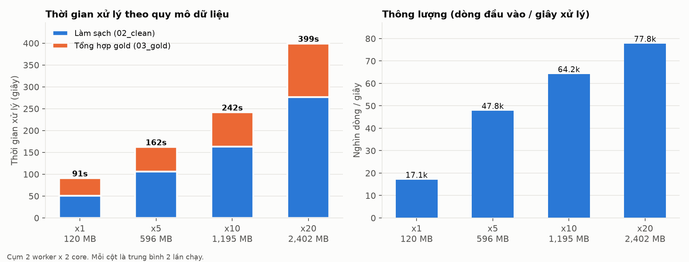
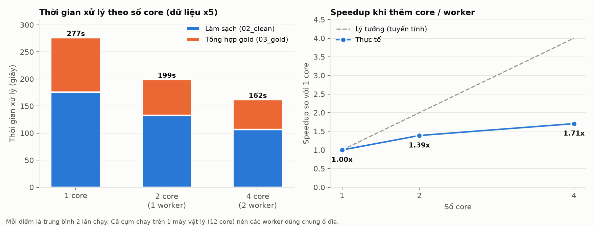

# 05 - Thực nghiệm: khả năng mở rộng của pipeline Processing

Tài liệu này giải thích **bước 6**: thí nghiệm gì, chạy thế nào, kết quả ra sao và nghĩa là
gì. Số liệu đầy đủ nằm ở [`reports/experiments/results.md`](../reports/experiments/results.md)
(trung bình) và [`results.csv`](../reports/experiments/results.csv) (từng lần chạy).

---

## 1. Vì sao cần thực nghiệm?

Bộ Olist gốc chỉ có 120 MB. Với cỡ này Pandas vẫn xử lý được, nên câu hỏi tự nhiên là:
*"Cần gì Spark?"*. Thực nghiệm trả lời bằng **số đo** cho 3 câu hỏi:

| Câu hỏi | Thí nghiệm |
|---|---|
| Khi dữ liệu lớn gấp 5, 10, 20 lần, pipeline còn chạy đúng không, và chậm đi bao nhiêu? | **E1 - Quy mô dữ liệu** |
| Thêm core / thêm máy thì nhanh hơn bao nhiêu? | **E2 - Tài nguyên** |
| Spark có tự thay đổi cách xử lý khi dữ liệu lớn lên không? | Quan sát execution plan trong E1 |

Tương tự bên web: đây là **load test**. Ta không chỉ chứng minh API chạy đúng với 1 người dùng,
mà đo xem nó chịu được bao nhiêu khi tải tăng lên.

---

## 2. Cách làm

### 2.1. Sinh dữ liệu lớn hơn: [`jobs/scale_data.py`](../jobs/scale_data.py)

Nhân bản dữ liệu thô N lần, **giữ nguyên định dạng CSV gốc**. Mỗi bản sao k là một "sàn
thương mại song song": mọi ID được thêm hậu tố `_k` (ví dụ `order_id` → `<id>_3`), nên ID
không trùng nhưng quan hệ khoá ngoại vẫn đúng.

| Quy mô | Dung lượng CSV | Số bản ghi |
|---|---:|---:|
| x1 (gốc) | 120 MB | 1,55 triệu |
| x5 | 596 MB | 7,75 triệu |
| x10 | 1,2 GB | 15,5 triệu |
| x20 | 2,4 GB | 31,0 triệu |

Vì nhân bản có quy luật, **doanh thu ở xN phải đúng bằng N lần x1**. Đây là cách kiểm tra
pipeline vẫn tính đúng khi dữ liệu lớn.

### 2.2. Chạy CÙNG một code trên dữ liệu khác nhau

Các job đọc đường dẫn từ biến môi trường (`OLIST_RAW_DIR`, `OLIST_LAKE_DIR`,
`OLIST_REPORT_DIR`, xem [`olist_tables.py`](../jobs/olist_tables.py)). Nhờ đó pipeline ở
bước 4-5 chạy trên dữ liệu x20 mà **không sửa dòng code nào**, giống cấu hình `.env` cho
môi trường dev/staging/prod.

### 2.3. Điều phối: [`experiments/run_experiments.py`](../experiments/run_experiments.py)

Script chạy trên máy thật, gọi `spark-submit` cho từng cấu hình, đọc số đo từ file JSON mà
các job ghi ra, rồi lưu vào `results.csv`. **Mỗi cấu hình chạy 2 lần** và lấy trung bình,
vì thời gian có dao động (cache của hệ điều hành, JVM khởi động...).

Giới hạn số core bằng tham số của `spark-submit`, không phải tắt container:

| Cấu hình | Tham số | Ý nghĩa |
|---|---|---|
| 1 core | `--total-executor-cores 1 --executor-cores 1` | Xử lý 1 partition tại một thời điểm |
| 2 core (1 worker) | `--total-executor-cores 2 --executor-cores 2` | 1 executor chiếm trọn 1 worker |
| 4 core (2 worker) | `--total-executor-cores 4 --executor-cores 2` | Cụm đầy đủ |

**Thời gian xử lý** = thời gian làm sạch (bước 4) + thời gian tạo gold (bước 5). Con số này
**không** gồm khởi động Spark và các bước kiểm tra lại / đối chiếu số liệu.

### 2.4. Môi trường đo

Laptop Intel i5-11400H (6 nhân / 12 luồng), RAM 24 GB, SSD NVMe. Cụm Spark gồm 3 container
Docker trên cùng máy này.

---

## 3. E1 - Quy mô dữ liệu (cụm đầy đủ 4 core)



| Quy mô | CSV vào | Thời gian xử lý | Dữ liệu tăng | Thời gian tăng | Thông lượng | Join sort-merge / tổng | Đối chiếu | Doanh thu hợp lệ |
|---|---:|---:|---:|---:|---:|---:|---|---:|
| x1 | 120 MB | **90,8 s** | 1x | 1,0x | 17,1 nghìn dòng/s | 0 / 10 | 11/11 | 13.494.400,74 |
| x5 | 596 MB | **162,1 s** | 5x | 1,8x | 47,8 nghìn dòng/s | 5 / 10 | 11/11 | 67.472.003,70 |
| x10 | 1,2 GB | **241,6 s** | 10x | 2,7x | 64,2 nghìn dòng/s | 8 / 10 | 11/11 | 134.944.007,40 |
| x20 | 2,4 GB | **399,0 s** | 20x | 4,4x | 77,8 nghìn dòng/s | 8 / 10 | 11/11 | 269.888.014,80 |

Mỗi cấu hình chạy 2 lần; 2 lần chênh nhau tối đa khoảng 7% (ở x1, nơi thời gian ngắn nên dao động lớn hơn), các quy mô khác dưới 5%.

### Nhận xét

**1. Kết quả đúng ở mọi quy mô.** Cả 11 kiểm tra đối chiếu đều đạt, và doanh thu ở x5, x10,
x20 **đúng bằng** 5, 10, 20 lần x1, khớp tới từng xu.

**2. Dữ liệu tăng 20 lần nhưng thời gian chỉ tăng 4,4 lần.** Lý do là thời gian chạy gồm 2 phần:

```
Thời gian ≈ 86 s (chi phí cố định) + 0,13 s × (số MB dữ liệu)
```

Công thức này được tính từ 2 điểm x10 và x20. Nó dự đoán x5 mất 163,5 s, và thực tế đo được
162,1 s, tức là **khớp**.

- **Chi phí cố định khoảng 86 s** không phụ thuộc lượng dữ liệu. Pipeline gồm hàng chục job
  Spark nhỏ (đếm dòng, ghi file, đọc lại để kiểm tra...), và mỗi job đều tốn thời gian lập kế
  hoạch, chia task và khởi động. Ở x1, **gần như toàn bộ thời gian là chi phí cố định này**.
  Đó là lý do với dữ liệu nhỏ, Spark không nhanh hơn Pandas.
- **Phần tăng theo dữ liệu** khoảng 0,13 s/MB (tức khoảng 7,7 MB/s) gần như **tuyến tính**.
  Từ x5 trở đi, thời gian tăng đều theo lượng dữ liệu, không bị "vỡ trận" khi dữ liệu lớn.

> Ngoại suy (chưa đo, chỉ ước tính): x100 (khoảng 12 GB) mất khoảng 1.650 s, tức khoảng 28 phút,
> trên cùng cụm 4 core, với điều kiện quan hệ tuyến tính vẫn giữ.

**3. Thông lượng tăng 4,5 lần** (17 → 78 nghìn dòng/giây): dữ liệu càng lớn, chi phí cố định
càng được "chia đều", và cụm được dùng hiệu quả hơn.

**4. Spark tự đổi chiến lược join** (xem [`reports/experiments/plans/`](../reports/experiments/plans/)):

| Quy mô | Join trong `fact_order_items` |
|---|---|
| x1 | Cả 6 join đều **broadcast**: mọi bảng nhỏ hơn 10 MB, được gửi nguyên bản tới mọi executor |
| x20 | `orders`, `customers`, reviews, payments chuyển sang **sort-merge**. `products`, `sellers` vẫn **broadcast** vì 2 bảng này vẫn nhỏ. |

Spark chọn cách join **cho từng bảng** dựa trên kích thước, không cần sửa code. Đây là lợi thế
của việc viết logic bằng SQL/DataFrame và để bộ tối ưu (Catalyst + AQE) quyết định cách chạy.

**5. Điểm nghẽn là bảng `geolocation`.** Ở x20, riêng việc làm sạch bảng này mất khoảng 167 s
trên 271 s của bước làm sạch (61%), vì phải loại trùng 20 triệu dòng toạ độ.

---

## 4. E2 - Số core / worker (dữ liệu x5 = 596 MB)



| Cấu hình | Thời gian xử lý | Speedup | Hiệu suất (speedup / số core) |
|---|---:|---:|---:|
| 1 core | 276,6 s | 1,00x | 100% |
| 2 core (1 worker) | 199,3 s | 1,39x | 69% |
| 4 core (2 worker) | 162,1 s | 1,71x | 43% |

### Nhận xét

**1. Thêm core thì nhanh hơn, nhưng không gấp đôi.** Đây là **định luật Amdahl**: phần
việc chỉ chạy được tuần tự giới hạn mức tăng tốc tối đa. Tách thời gian thành 2 phần (tính
từ cấu hình 1 core và 4 core):

```
Thời gian(n core) ≈ 124 s (không song song được) + 153 s / n (song song được)
```

Công thức dự đoán 2 core mất 200,3 s, thực tế đo được 199,3 s, tức là **khớp**.

Ở x5, chỉ khoảng **55%** công việc song song được. Dù có vô hạn core, thời gian cũng không thể
thấp hơn 124 s, tức speedup tối đa khoảng **2,2x**.

**2. Phần không song song được đến từ đâu?**
- Chi phí cố định của các job Spark nhỏ (đã thấy ở E1).
- Các bước chỉ có 1 task: bảng tổng hợp ghi thành 1 file (`coalesce(1)`), bảng nhỏ chỉ có 1
  partition (`sellers`, bảng dịch danh mục).
- Driver xử lý tuần tự: đọc kết quả `.collect()`, ghi báo cáo.

**3. Vì sao vẫn đáng thêm máy?** Phần song song được **tăng theo dữ liệu** (0,13 s/MB ở E1),
còn phần cố định thì không. Vì vậy dữ liệu càng lớn, tỷ lệ song song càng cao và thêm core
càng có lợi. Ở x5 phần song song là 55%; ở x20 có thể cao hơn. Đây là **giả thuyết**, chưa
được đo ở thí nghiệm này (xem mục 6).

**4. Các yếu tố làm speedup đo được thấp hơn thực tế:**
- "1 core" giới hạn số **task** chạy cùng lúc, nhưng JVM vẫn dùng thêm luồng nền (dọn bộ nhớ,
  nén Parquet, đọc/ghi đĩa). Khi chạy cấu hình 1 core, Docker ghi nhận worker dùng khoảng
  160% CPU. Như vậy mốc "1 core" thực ra nhanh hơn 1 core thật, làm speedup trông thấp hơn.
- Ba "máy" là 3 container trên **cùng 1 laptop**, dùng chung SSD và bộ nhớ đệm CPU. Trên cụm
  máy thật, mỗi máy có ổ đĩa và RAM riêng.

---

## 5. Kết luận cho đặc trưng Big Data (dùng cho báo cáo)

| Đặc trưng | Bằng chứng từ thực nghiệm |
|---|---|
| **Volume**: xử lý được dữ liệu lớn | Cùng code chạy đúng từ 120 MB tới 2,4 GB / 31 triệu bản ghi; 11/11 kiểm tra đạt ở mọi quy mô |
| **Mở rộng theo dữ liệu** | Thời gian tăng tuyến tính (khoảng 0,13 s/MB) sau chi phí cố định 86 s; dữ liệu x20 chỉ tốn 4,4x thời gian |
| **Xử lý phân tán** | 2 worker nhanh hơn 1 core 1,71x; mô hình Amdahl giải thích được giới hạn |
| **Tự thích nghi** | Spark tự chuyển broadcast → sort-merge join khi bảng vượt 10 MB |

**Khi nào Spark đáng dùng?** Ở 120 MB, chi phí cố định của Spark (khoảng 86 s) chiếm phần lớn thời
gian, nên Pandas trên 1 máy sẽ nhanh hơn. Lợi thế của Spark chỉ xuất hiện khi dữ liệu đủ lớn để
phần xử lý dữ liệu vượt xa chi phí cố định, và **đặc biệt khi dữ liệu không còn vừa RAM của
một máy**. Lúc đó Pandas không chạy được, còn Spark chỉ cần thêm worker.

---

## 6. Hạn chế của thí nghiệm và hướng mở rộng

- **Cụm giả lập trên 1 máy.** Không đo được tác động của mạng thật giữa các máy, và không
  có data locality như HDFS.
- **Dữ liệu nhân bản có quy luật.** Phân bố dữ liệu giống hệt nhau giữa các bản sao. Bảng
  `geolocation` cũng bị nhân lên, trong khi thực tế số mã zip không tăng theo số đơn hàng, nên
  thời gian làm sạch geolocation trong thí nghiệm **cao hơn thực tế**.
- **Chỉ 2 lần chạy mỗi cấu hình.** Đủ thấy xu hướng (chênh lệch giữa 2 lần tối đa khoảng 7%), nhưng chưa đủ để
  kết luận thống kê chặt chẽ.
- **E2 chỉ đo ở x5.** Nên đo thêm speedup ở x20 để kiểm chứng giả thuyết ở mục 4.3.
- **Hướng tối ưu đã nhận diện được:**
  - giảm chi phí cố định bằng cách gộp các lần `.count()` kiểm tra;
  - bảng `geolocation` chỉ cần làm sạch một lần vì ít thay đổi;
  - tăng số partition cho bảng reviews.

---

## 7. Cách chạy lại

```bash
docker compose up -d
python experiments/run_experiments.py          # toàn bộ: ~1,5 giờ, cần ~4 GB đĩa trống
python experiments/run_experiments.py --quick  # thử nhanh: x1, x5, mỗi cấu hình 1 lần
pip install matplotlib
python experiments/plot_results.py             # vẽ lại biểu đồ từ results.csv
```

Script **chạy tiếp từ chỗ dừng** nếu bị ngắt (bỏ qua các lần đã có trong `results.csv`). Dữ
liệu nhân bản nằm ở `data/scale/` (khoảng 4,2 GB), có thể xoá sau khi chạy xong.
